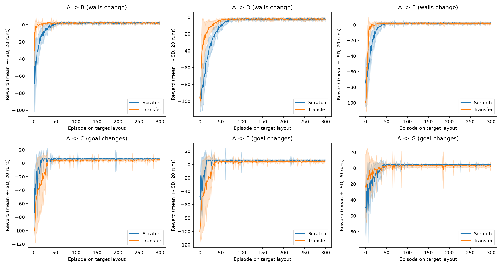

# Transfer of a Q-Table Across Grid-World Layouts

A small independent prototype in tabular Q-learning, **inspired by** the research theme of Project 6 of the
CaCTüS Internship ("Schema Learning in Deep Meta-Reinforcement Learning for One-Shot Spatial Navigation").
It is **not** a reproduction of that project.

## Research question

If a Q-learning agent has already learned one grid layout (Layout A), does reusing its Q-table speed up or slow down
learning in a modified layout, compared with learning from scratch? Does the answer depend on whether the **walls** or
the **goal** change?

## Original project vs. this prototype

| | Original CaCTüS project | This prototype |
|---|---|---|
| Agent | Meta-RL with recurrent neural networks | Tabular Q-learning (no neural network) |
| Task | Paired-association navigation, one-shot learning | Navigation to a fixed goal in a 5x5 grid |
| Representations | Place cells, hippocampal-style remapping | None (state = grid cell) |
| Focus | Schema learning mechanisms | Scratch vs. transfer of a Q-table |

The results here say nothing about schema learning itself.

## Setup (Windows)

```
python -m pip install numpy matplotlib
```

Tested with Python 3.13.14, NumPy 2.5.4, Matplotlib 3.11.2.

## Environment and layouts

5x5 grid, start (0,0), actions up/down/left/right. Reward +10 at the goal, -1 for every other step.
Walls and borders block movement. An episode ends at the goal or after 100 steps.

| Layout | Role | Walls | Goal | Shortest path |
|---|---|---|---|---|
| A | source | (1,1),(2,2),(3,3) | (4,4) | 8 |
| B | target, walls change | (0,2),(1,2),(3,1),(3,2),(3,3) | (4,4) | 8 |
| D | target, walls change | (1,0),(1,1),(1,2),(3,2),(3,3),(3,4) | (4,4) | 12 |
| E | target, walls change | (2,0),(2,1),(2,3),(2,4) | (4,4) | 8 |
| C | target, goal changes | as in A | (0,4) | 4 |
| F | target, goal changes | as in A | (4,0) | 4 |
| G | target, goal changes | as in A | (2,4) | 6 |

## Method

- Q-learning with alpha = 0.1, gamma = 0.9, epsilon = 0.1. No bootstrapping from terminal states; ties between equal Q-values are broken randomly. Hyperparameters were not tuned.
- **Scratch:** 300 episodes on the target layout from a zero Q-table.
- **Transfer:** 500 episodes on Layout A, then 300 episodes on the target layout with the same Q-table.
- 20 runs per condition and target. Scratch and transfer use **independent** random streams (a separate `random.Random` seeded from text such as `scratch-train-C-7`), so results are exactly reproducible.
- Metrics per run: mean reward over the first 50 target episodes (early learning) and the last 50 (final performance).
- After training, each agent is evaluated for 20 greedy (epsilon = 0) episodes: success rate, mean path length of successful episodes, number of failures. The environment is deterministic, so these episodes differ only through random tie-breaking.
- Mean +- SD across the 20 runs. Exploratory permutation tests with Bonferroni adjustment are in the report; no claim of statistical significance is made.

## How to run

```
python run_v2.py
python make_report_v2.py
```

`run_v2.py` writes everything to the folder `results_v2/` (summary CSV, per-run CSV, JSON, text summary, learning curves).
`make_report_v2.py` builds `REPORT_v2.md` from those results.

## Results (mean +- SD over 20 runs)

| Target | Change | Early reward (scratch / transfer) | Final reward (scratch / transfer) | Greedy path (scratch / transfer) | Shortest |
|---|---|---|---|---|---|
| B | walls | -14.71 +- 0.65 / -0.12 +- 0.92 | 2.14 +- 0.16 / 1.97 +- 0.22 | 8.00 / 8.00 | 8 |
| D | walls | -43.05 +- 0.94 / -20.80 +- 7.89 | -2.46 +- 0.23 / -2.44 +- 0.22 | 12.00 / 12.00 | 12 |
| E | walls | -20.23 +- 0.87 / -9.30 +- 3.23 | 2.01 +- 0.28 / 1.94 +- 0.24 | 8.00 / 8.00 | 8 |
| C | goal | -3.85 +- 0.80 / -20.91 +- 18.36 | 6.51 +- 0.15 / 4.73 +- 0.83 | 4.00 / 5.40 | 4 |
| F | goal | -3.36 +- 1.04 / -21.39 +- 18.65 | 6.46 +- 0.18 / 4.53 +- 0.81 | 4.00 / 5.60 | 4 |
| G | goal | -12.62 +- 0.83 / -4.88 +- 10.64 | 4.32 +- 0.19 / 2.95 +- 1.93 | 6.00 / 7.20 | 6 |

All greedy evaluations reached the goal (0 failures out of 400 episodes per condition and layout).



## Findings (exploratory)

- **Walls change (B, D, E):** transfer improved early learning in all three layouts; final reward and greedy path length were practically the same as scratch.
- **Goal changes (C, F):** transfer was worse than scratch both early and at the end, and its greedy paths were longer than optimal (5.4 and 5.6 steps vs. 4).
- **Goal changes (G):** mixed result. Transfer was better early but worse at the end, with a longer greedy path (7.20 vs. 6.00).
- So the simple rule "wall changes help, goal changes hurt" holds for 5 of the 6 layouts, but not for G.
- Why this happens was not tested. A plausible hypothesis is that old Q-values pointing to the old goal must be overwritten.

## Limitations

- Tiny deterministic 5x5 environment; one source layout and six hand-chosen target layouts.
- 20 runs per condition; statistical tests are exploratory and depend on the chosen metrics and layouts.
- Training lengths and hyperparameters were not varied or tuned.
- Final-episode reward includes epsilon exploration, so it is below the optimal reward.
- Tabular Q-learning cannot form reusable abstractions.

## Possible future work

- More systematic goal and wall variations, and different pretraining lengths.
- Inspecting the learned Q-values to test the overwriting hypothesis.
- A recurrent (LSTM) agent trained across many layouts, and place-cell-like representations with shuffled remapping.

## Files

- `gridworld.py`: environment
- `layouts.py`: layouts A-G
- `q_agent.py`: action selection and Q-learning update
- `run_v2.py`: experiments, results and plots (version 2)
- `make_report_v2.py`: builds the report from the results
- `REPORT_v2.md`: research report with all tables
- `results_v2/`: outputs of `run_v2.py`
- `run_all_v1.py`, `v1_original/`: first version (2 target layouts, one greedy rollout, shared random stream), preserved unchanged