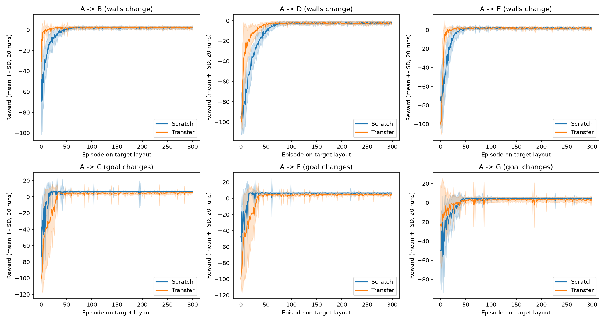

# Transfer of a Q-Table Across Grid-World Layouts: A Tabular Q-Learning Prototype (Version 2)

## Abstract
This report describes a small independent prototype inspired by the research theme of Project 6 of the CaCTüS Internship (schema learning in meta-reinforcement learning for spatial navigation). It is **not** a reproduction of that project. I tested whether a tabular Q-learning agent pretrained on one 5x5 grid layout (Layout A) learns faster or slower in modified layouts than an agent trained from scratch. Six target layouts were used: three where only the walls change and three where only the goal moves. Each condition was run 20 times with independent random streams, and every trained agent was evaluated over 20 greedy episodes. All numbers below were produced by `run_v2.py`.

## 1. Background and scope
The original project asks whether recurrent meta-RL agents can discover schema-learning mechanisms for fast adaptation in new environments. This prototype implements only a much simpler idea: reuse of learned values (a Q-table) between similar navigation tasks. It has no neural network, no meta-learning, no paired-association task and no place-cell representation, so it provides no evidence about schema learning itself. Its purpose is a reproducible experimental pipeline and a baseline for future work.

## 2. Research question
Does initialising a Q-learning agent with a Q-table learned on Layout A speed up or slow down learning on a modified target layout, compared with learning from scratch, and does the answer depend on whether the walls or the goal change?

## 3. Methods
**Environment.** 5x5 grid, start (0,0), actions up/down/left/right. Reward +10 at the goal and -1 for every other step. Walls and borders block movement. An episode ends at the goal or after 100 steps.

**Layouts.** Source A: walls (1,1),(2,2),(3,3), goal (4,4). Targets where only the walls change (goal (4,4)): B walls (0,2),(1,2),(3,1),(3,2),(3,3); D walls (1,0),(1,1),(1,2),(3,2),(3,3),(3,4); E walls (2,0),(2,1),(2,3),(2,4). Targets where only the goal changes (walls as in A): C goal (0,4); F goal (4,0); G goal (2,4). Shortest path lengths (found by breadth-first search): B = 8, D = 12, E = 8, C = 4, F = 4, G = 6 steps.

**Agent.** Tabular Q-learning with alpha = 0.1, gamma = 0.9, epsilon = 0.1. No bootstrapping from terminal states; ties between equal Q-values are broken randomly. Hyperparameters were not tuned.

**Conditions.** *Scratch*: 300 episodes on the target layout from a zero Q-table. *Transfer*: 500 episodes on Layout A, then 300 episodes on the target layout with the same Q-table.

**Random seeds.** Every random purpose uses its own generator (`random.Random`) created from a text seed such as `scratch-train-C-7`. Therefore the scratch and transfer conditions use **independent** random streams (they are not matched run by run), and re-running the script gives identical results. For transfer, pretraining on Layout A uses the stream `pretrain-<run>`; the same pretrained Q-table of run *i* is copied to every target layout (so the transfer runs of different targets share their source table, but the comparison scratch vs transfer within a target uses independent samples). The earlier version 1 (see Section 7) drew scratch and transfer from one shared stream.

**Evaluation.** 20 runs per condition and target. Metrics per run: mean reward over the first 50 target episodes (early learning) and over the last 50 (final performance, includes epsilon exploration). After training, each agent is evaluated for 20 greedy (epsilon = 0, no learning) episodes. The environment is deterministic, so these episodes differ only through random tie-breaking between equal Q-values. From them I report the success rate, the mean path length of successful episodes, and the number of failed episodes (goal not reached within 100 steps). Mean and standard deviation (SD, sample SD with n-1) are taken across the 20 runs.

**Statistical testing.** For early and final reward I ran a two-sided permutation test (10000 shuffles) comparing scratch and transfer per target. Because 12 tests were run, I also report Bonferroni-adjusted p-values (p x 12, capped at 1). These tests are exploratory: they use only 20 runs per group, assume runs are exchangeable, and the choice of metrics and layouts was made by me. I do not make claims of statistical significance beyond reporting these values.

## 4. Results
### 4.1 Learning speed and final reward (mean +- SD over 20 runs)

| Target | Change | Early reward scratch | Early reward transfer | adj. p (early) | Final reward scratch | Final reward transfer | adj. p (final) |
|---|---|---|---|---|---|---|---|
| A -> B | walls change | -14.71 +- 0.65 | -0.12 +- 0.92 | 0.001 | 2.14 +- 0.16 | 1.97 +- 0.22 | 0.085 |
| A -> D | walls change | -43.05 +- 0.94 | -20.80 +- 7.89 | 0.001 | -2.46 +- 0.23 | -2.44 +- 0.22 | 1.000 |
| A -> E | walls change | -20.23 +- 0.87 | -9.30 +- 3.23 | 0.001 | 2.01 +- 0.28 | 1.94 +- 0.24 | 1.000 |
| A -> C | goal changes | -3.85 +- 0.80 | -20.91 +- 18.36 | 0.002 | 6.51 +- 0.15 | 4.73 +- 0.83 | 0.001 |
| A -> F | goal changes | -3.36 +- 1.04 | -21.39 +- 18.65 | 0.002 | 6.46 +- 0.18 | 4.53 +- 0.81 | 0.001 |
| A -> G | goal changes | -12.62 +- 0.83 | -4.88 +- 10.64 | 0.030 | 4.32 +- 0.19 | 2.95 +- 1.93 | 0.011 |

### 4.2 Greedy evaluation (20 episodes per agent)

| Target | Shortest path | Condition | Success rate (mean +- SD) | Mean successful path (mean +- SD over agents) | Agents counted | Failed episodes |
|---|---|---|---|---|---|---|
| A -> B | 8 | scratch | 1.000 +- 0.000 | 8.00 +- 0.00 | 20/20 | 0/400 |
| A -> B | 8 | transfer | 1.000 +- 0.000 | 8.00 +- 0.00 | 20/20 | 0/400 |
| A -> D | 12 | scratch | 1.000 +- 0.000 | 12.00 +- 0.00 | 20/20 | 0/400 |
| A -> D | 12 | transfer | 1.000 +- 0.000 | 12.00 +- 0.00 | 20/20 | 0/400 |
| A -> E | 8 | scratch | 1.000 +- 0.000 | 8.00 +- 0.00 | 20/20 | 0/400 |
| A -> E | 8 | transfer | 1.000 +- 0.000 | 8.00 +- 0.00 | 20/20 | 0/400 |
| A -> C | 4 | scratch | 1.000 +- 0.000 | 4.00 +- 0.00 | 20/20 | 0/400 |
| A -> C | 4 | transfer | 1.000 +- 0.000 | 5.40 +- 0.94 | 20/20 | 0/400 |
| A -> F | 4 | scratch | 1.000 +- 0.000 | 4.00 +- 0.00 | 20/20 | 0/400 |
| A -> F | 4 | transfer | 1.000 +- 0.000 | 5.60 +- 0.82 | 20/20 | 0/400 |
| A -> G | 6 | scratch | 1.000 +- 0.000 | 6.00 +- 0.00 | 20/20 | 0/400 |
| A -> G | 6 | transfer | 1.000 +- 0.000 | 7.20 +- 1.88 | 20/20 | 0/400 |

'Agents counted' is the number of agents with at least one successful greedy episode (only those enter the path statistic).

### 4.3 Summary of findings (generated from the table above)

- **A -> B (walls change):** early reward higher with transfer (difference +14.59, adjusted p = 0.001); final reward lower (difference -0.17, adjusted p = 0.085); mean successful greedy path 8.00 (transfer) vs 8.00 (scratch), optimal 8.
- **A -> D (walls change):** early reward higher with transfer (difference +22.25, adjusted p = 0.001); final reward higher (difference +0.02, adjusted p = 1.000); mean successful greedy path 12.00 (transfer) vs 12.00 (scratch), optimal 12.
- **A -> E (walls change):** early reward higher with transfer (difference +10.94, adjusted p = 0.001); final reward lower (difference -0.06, adjusted p = 1.000); mean successful greedy path 8.00 (transfer) vs 8.00 (scratch), optimal 8.
- **A -> C (goal changes):** early reward lower with transfer (difference -17.06, adjusted p = 0.002); final reward lower (difference -1.78, adjusted p = 0.001); mean successful greedy path 5.40 (transfer) vs 4.00 (scratch), optimal 4.
- **A -> F (goal changes):** early reward lower with transfer (difference -18.03, adjusted p = 0.002); final reward lower (difference -1.92, adjusted p = 0.001); mean successful greedy path 5.60 (transfer) vs 4.00 (scratch), optimal 4.
- **A -> G (goal changes):** early reward higher with transfer (difference +7.74, adjusted p = 0.030); final reward lower (difference -1.38, adjusted p = 0.011); mean successful greedy path 7.20 (transfer) vs 6.00 (scratch), optimal 6.

- Across the 3 layouts where the **walls change**: transfer had higher early reward in 3 of 3, lower final reward in 2 of 3, and a longer mean greedy path in 0 of 3.
- Across the 3 layouts where the **goal changes**: transfer had higher early reward in 1 of 3, lower final reward in 3 of 3, and a longer mean greedy path in 3 of 3.
- Failed greedy episodes over all agents and layouts: 0 of 4800.

## 5. Discussion
The early-reward pattern of the first two experiments (transfer helps when walls change, hurts when the goal moves) did **not** hold in every layout; see the per-layout lines in Section 4.3. The simple rule 'wall change helps, goal change hurts' is therefore not a general conclusion from these data.

A plausible but **untested** explanation is that when the goal stays fixed most source Q-values remain useful, while moving the goal makes many source values point toward the old goal, which must then be overwritten. How harmful this is probably depends on how far the new goal is from the old one and on the wall layout. Testing this would need, for example, inspecting the learned Q-values or varying the goal position systematically.

## 6. Limitations
- Tiny deterministic 5x5 environment; one source layout and six hand-chosen target layouts.
- 20 runs per condition; permutation tests are exploratory and p-values depend on the chosen metrics and layouts.
- Greedy evaluation episodes differ only through tie-breaking, so they are not independent samples of a stochastic environment.
- Source pretraining length (500 episodes) and target training length (300) were fixed and not varied; hyperparameters were not tuned.
- Final-episode reward includes epsilon exploration, so it is below the optimal reward.
- Tabular Q-learning cannot form reusable abstractions; these results say nothing about schema learning.

## 7. Earlier version (v1, preserved)
Version 1 (`run_all_v1.py`, outputs `results.txt` and `results_transfer.png`) used 20 runs on layouts B and C, one greedy rollout per agent and one shared random stream per run. Its results are kept unchanged. Because version 2 uses different random-number handling, the numbers differ slightly between versions; they should not be mixed in one table.

## 8. Future work
More systematic goal and wall variations, longer or shorter pretraining, more runs, a recurrent (LSTM) agent trained across many layouts, and place-cell-like state representations with shuffled remapping, which is closer to the original research question.

## 9. Reproducibility
Python 3.13.14, NumPy 2.5.4, run on 2026-11-12. Commands: `python run_v2.py` then `python make_report_v2.py`. Outputs: `results_v2/summary.csv`, `results_v2/per_run_results.csv`, `results_v2/results_v2.json`, `results_v2/results_v2.txt`, `results_v2/learning_curves_v2.png`.